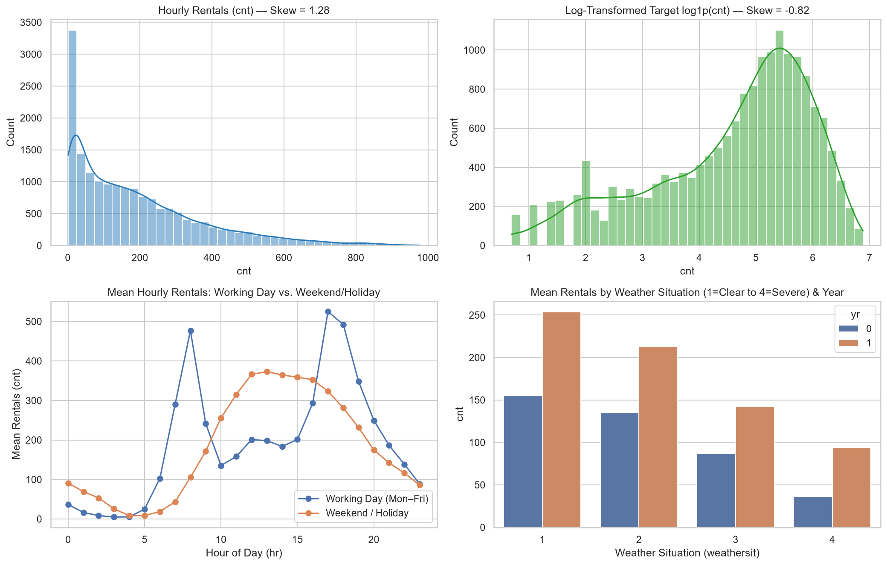

# Hourly Bike Sharing Demand Prediction

An end-to-end machine learning service that predicts hourly bike rental demand (`cnt`) using weather conditions and calendar signals, packaged with FastAPI and Docker.

## 1. Problem Statement & Business Context

Bike-sharing operators face constant supply-demand imbalances: stations near transit hubs and offices empty out during morning and evening rush hours, while residential or park stations overflow on sunny weekends.

This project predicts **total hourly bike rentals (`cnt`)** from weather forecasts and calendar features. Operations teams can use these hourly forecasts to:
- Schedule proactive truck rebalancing before commuter peaks (8:00 AM and 5:00–6:00 PM).
- Adjust maintenance windows during low-demand overnight or severe-weather hours.
- Plan seasonal fleet capacity across spring, summer, fall, and winter.

## 2. System Architecture

```text
[Offline Training]
data/hour_bike_sharing_data.csv ──▶ train.py (ColumnTransformer + Tuned LightGBM) ──▶ model.bin

[Online Inference Service (Docker / Port 9696)]
Client JSON (POST /predict) ──▶ serve.py (FastAPI + Pydantic) ──▶ predict.py + model.bin ──▶ {"predicted_rentals": 816.18}
```

## 3. Dataset Description

- **Source:** [UCI Machine Learning Repository — Bike Sharing Dataset](https://archive.ics.uci.edu/dataset/275/bike+sharing+dataset) (`hour.csv`, committed at `data/hour_bike_sharing_data.csv`).
- **Size:** 17,379 hourly observations across 17 columns covering January 1, 2011 to December 31, 2012 (0 missing values, 0 duplicate rows).
- **Target Variable:** `cnt` — total hourly bike rentals (mean: `189.46`, median: `142.00`, range: `1` to `977`).
- **Leakage Prevention:** `casual` and `registered` are dropped prior to modeling because `casual + registered == cnt` identically across every row. Row index `instant` and raw date string `dteday` are also excluded from features.
- **Features Used (12):**
  - **Categorical:** `season` (`1`–`4`), `mnth` (`1`–`12`), `hr` (`0`–`23`), `weekday` (`0`–`6`), `weathersit` (`1`–`4`).
  - **Numeric / Binary:** `yr` (`0`=2011, `1`=2012), `holiday` (`0`/`1`), `workingday` (`0`/`1`), and pre-normalized `[0, 1]` weather metrics (`temp`, `atemp`, `hum`, `windspeed`).

## 4. Exploratory Data Analysis (EDA) Highlights

Full interactive charts and feature importance plots are available in `notebook.ipynb`:
- **Right-Skewed Target:** Raw `cnt` has a skewness of `1.28`. Applying a `log1p(cnt)` transformation stabilizes variance across high-demand rush hours and improves tree-based regression accuracy.
- **Commuter vs. Leisure Regimes (`hr` × `workingday`):** Working days exhibit sharp bimodal peaks at **8:00 AM** and **5:00–6:00 PM**, whereas weekends and holidays follow a single smooth midday curve peaking between **12:00 PM and 4:00 PM**.
- **Year-over-Year Growth & Weather Sensitivity:** Mean hourly rentals grew 63% from 2011 (`143.79`) to 2012 (`234.67`), while precipitation (`weathersit >= 3`) and high humidity sharply suppress ridership.


## 5. Modeling & Evaluation

To prevent future data leakage, data is split **chronologically**:
- **Train:** Jan 1, 2011 – Aug 31, 2012 (14,491 rows)
- **Validation:** Sep 1, 2012 – Oct 31, 2012 (1,428 rows)
- **Test:** Nov 1, 2012 – Dec 31, 2012 (1,460 rows)

Linear (`Ridge`) and tree-based ensembles (`Random Forest`, `LightGBM`, `XGBoost`) were compared in `notebook.ipynb`, followed by `TimeSeriesSplit` hyperparameter tuning (`RandomizedSearchCV`):

| Model | Validation RMSE (Sep–Oct 2012) | Validation MAE (Sep–Oct 2012) |
| :--- | :---: | :---: |
| **LightGBM (Tuned)** | **78.33** | **51.38** |
| XGBoost (Tuned) | 86.95 | 57.61 |

Retraining the winning tuned **LightGBM** pipeline on `Train + Validation` (15,919 rows) inside `train.py` achieves on the unseen **Test Set (Nov–Dec 2012)**:
- **Test RMSE:** `67.84`
- **Test MAE:** `43.65`

## 6. Repository Structure

```text
bike-sharing-demand-prediction/
├── data/
│   └── hour_bike_sharing_data.csv   # Hourly dataset (17,379 rows)
├── notebook.ipynb                   # EDA, feature importance, model comparison & tuning
├── train.py                         # Reproducible training script; exports model.bin
├── predict.py                       # Standalone inference helper module
├── serve.py                         # FastAPI web service (/health and /predict)
├── model.bin                        # Serialized preprocessing + LightGBM pipeline
├── requirements.txt                 # Pinned Python dependencies
├── Dockerfile                       # Container definition (python:3.14-slim)
├── .dockerignore                    # Excludes .venv and .git from Docker builds
├── .gitignore                       # Git exclusions
└── README.md                        # Project documentation
```

## 7. Local Setup & Running Instructions

### Prerequisites
- Python 3.14+ (matching `requirements.txt` pins)
- Docker Desktop or Docker Engine (for containerized deployment)

### Step 1: Clone Repository & Activate Virtual Environment

**Linux / macOS:**
```bash
git clone [https://github.com/uwaisnajmi/bike-sharing-demand-prediction.git](https://github.com/uwaisnajmi/bike-sharing-demand-prediction.git)
cd bike-sharing-demand-prediction
python3 -m venv .venv
source .venv/bin/activate
pip install --upgrade pip
pip install -r requirements.txt
```

**Windows (PowerShell):**
```powershell
git clone [https://github.com/uwaisnajmi/bike-sharing-demand-prediction.git](https://github.com/uwaisnajmi/bike-sharing-demand-prediction.git)
cd bike-sharing-demand-prediction
python -m venv .venv
.venv\Scripts\Activate.ps1
python -m pip install --upgrade pip
pip install -r requirements.txt
```

### Step 2: Train the Model & Test Standalone Inference
```bash
python train.py
python predict.py
```
This evaluates the pipeline on the holdout test split, saves `model.bin`, and runs a sample prediction.

### Step 3: Run the FastAPI Service Locally
```bash
python serve.py
```
The API will listen on `http://localhost:9696` (interactive Swagger UI available at `http://localhost:9696/docs`).

## 8. Running with Docker

Open new terminal and type command below:

```bash
docker build -t bike-sharing-demand .
docker run --rm -p 9696:9696 bike-sharing-demand
```

## 9. API Usage Examples

### Health Check (`GET /health`)
```bash
curl -X GET http://localhost:9696/health
```
Response:
```json
{"status":"ok"}
```

### Predict Hourly Rentals (`POST /predict`)

**Using `curl` (Linux / macOS / Git Bash):**
```bash
curl -X POST http://localhost:9696/predict \
  -H "Content-Type: application/json" \
  -d '{
    "season": 3,
    "yr": 1,
    "mnth": 8,
    "hr": 17,
    "holiday": 0,
    "weekday": 4,
    "workingday": 1,
    "weathersit": 1,
    "temp": 0.76,
    "atemp": 0.70,
    "hum": 0.50,
    "windspeed": 0.19
  }'
```

**Using PowerShell (Windows):**
```powershell
$body = '{"season":3,"yr":1,"mnth":8,"hr":17,"holiday":0,"weekday":4,"workingday":1,"weathersit":1,"temp":0.76,"atemp":0.70,"hum":0.50,"windspeed":0.19}'
Invoke-RestMethod -Uri "http://localhost:9696/predict" -Method Post -ContentType "application/json" -Body $body | ConvertTo-Json
```

Response:
```json
{
  "predicted_rentals": 816.18
}
```

## 10. Known Limitations & Next Steps

- **Historical Fleet Scale:** The dataset reflects Washington, D.C. ridership from 2011–2012; deploying on modern systems requires retraining on recent ridership logs or removing the binary `yr` trend indicator in favor of rolling demand lag features.
- **Next Steps:** Add cyclical sine/cosine encodings for `hr` and `mnth`, incorporate lagged ridership features (`cnt_lag_1h`, `cnt_lag_24h`), and deploy the container to a managed cloud service with automated CI/CD.